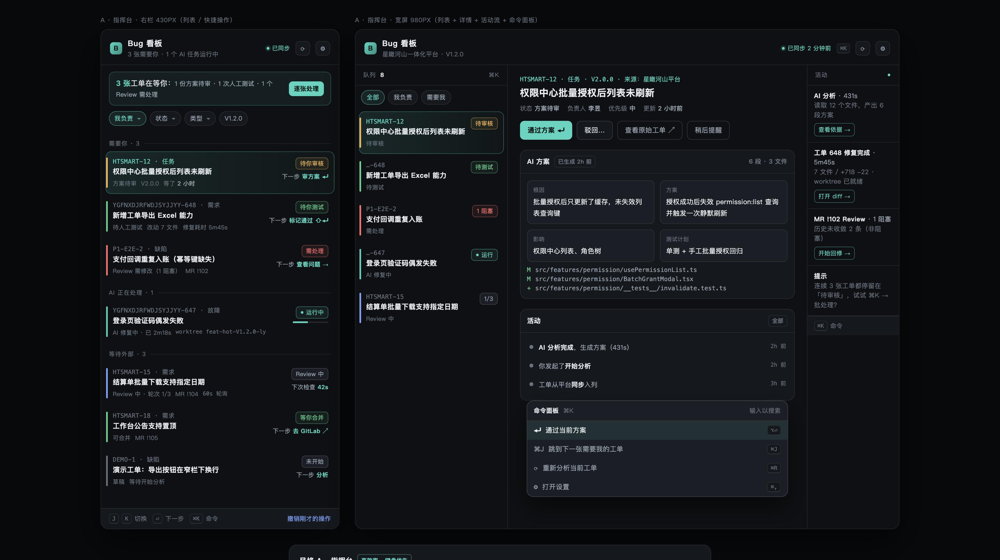
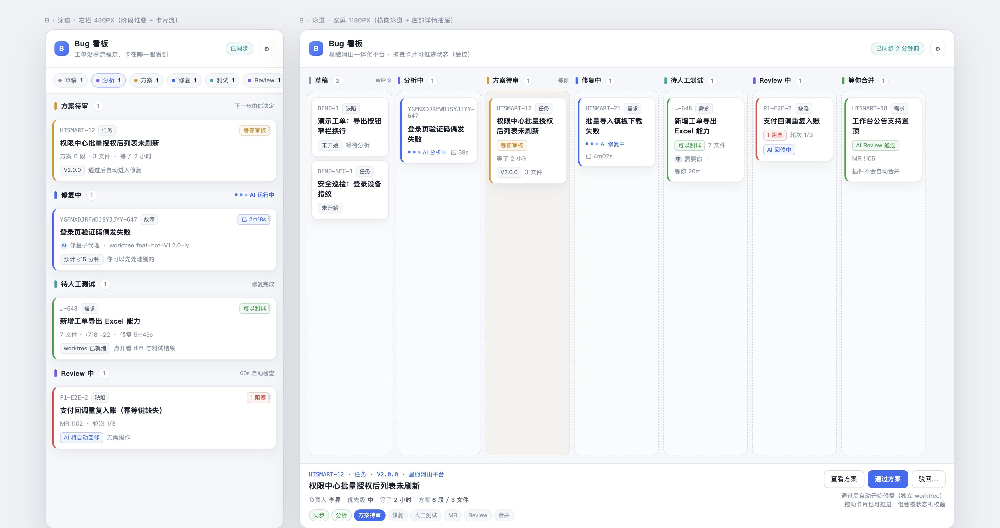
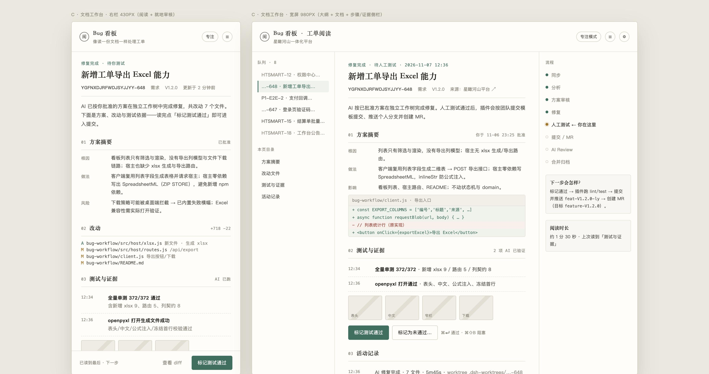
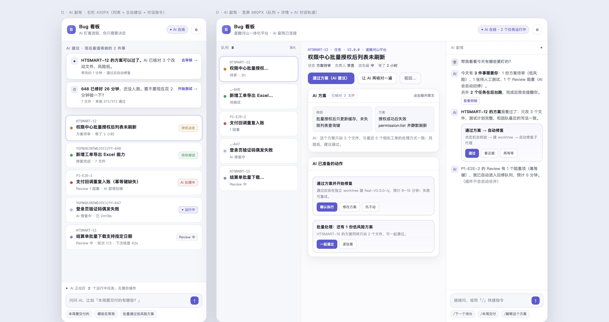

# Bug 看板 UI 重设计 · 4 个风格方向（待选）

> 日期：2026-11-07 · 范围：`bug-workflow` 插件看板 UI（列表 / 详情 / 设置 / 状态反馈），**不改宿主接口、状态机、存储与子代理流程**；只重做表现层与交互层。
> 现场：右栏 tab 宽度实测 300–600px 可用；宽屏模式可展开到 900–1200px；DSH 主题 token 为 `--dsw-alias-*`（明/暗两套）；client 是单文件 React bundle，仅 `require('react')`、无新依赖。
> 约束（必须先满足）：所有色值映射到主题 token（明暗都要可用）；`aria-live` 计时遵循现有规则；动作仍走 `ACTION_BY_STATE` + 宿主校验；不引入 iframe / 外部资源。
> 参考知识：[[坑-flex子项内滚动必须配min-height0]]（三段式布局）、[[模式-大屏多模块筛选单一数据源与事件总线]]（筛选 chip 单一数据源）。

## 1. 现状诊断（为什么值得重做）

| 问题 | 现象 | 影响 |
| --- | --- | --- |
| 信息架构平铺 | 列表按 workflow 分组，但「需要我 / AI 在跑 / 等外部」混在一起 | 每次都要逐行判断「现在该做什么」 |
| 下一步不明确 | 状态标签只说明「在哪」，不说明「接下来做什么、等谁」 | 用户需要读文档才能操作 |
| 窄栏挤压 | 卡片/按钮在 300–400px 下换行、详情层级深 | 高频操作效率低 |
| 反馈弱 | 分析/修复进度只有文案+秒数；AI 产出与人工操作混在一起 | 不知道 AI 在做什么、是否卡住 |
| 错误不可操作 | 阻塞原因多为静态文案 | 只能人工排查 |
| 大列表无检索 | 无搜索、无快捷筛选、无批量 | 10+ 工单后靠滚动 |

## 2. 四个风格方向（截图见同目录）

### A · 指挥台 Command Deck（深色 · 效率优先）

- **定位**：每天处理 10+ 工单、键盘优先的重度用户。
- **视觉**：深色面板 + 青色状态光；左侧 3px 状态轨替代大色块；等宽编号、紧凑行高。
- **信息架构**：自动分组「需要你 / AI 处理中 / 等待外部」；每行直接给出**下一步动作**（审方案 ⏎ / 标记通过 ⇧⏎ / 查看问题 →）、等待时长、耗时。
- **交互增强**：⌘K 命令面板、J/K 切换、⏎ 执行下一步、⌘J 跳到下一张待办、操作撤销 Toast、批处理入口。
- **宽屏**：三栏（队列 / 详情 / 活动流），AI 活动与时间线常驻。
- **实现量**：中；**风险**：深色需要主题适配，新用户需一次引导。

### B · 流程泳道 Flow Lanes（浅色 · 全局感）

- **定位**：站会/评审投屏、向团队解释流程；状态多、想「一眼看全局」。
- **视觉**：浅色卡片 + 阶段色条；「人在等你」泳道琥珀高亮；AI 运行脉冲点。
- **信息架构**：横向泳道 = 状态机阶段（12 状态聚合为 7 条展示泳道）；窄栏自动降级为「阶段分组卡片流」。
- **交互增强**：卡片拖拽推进（宿主状态机二次校验，非法回弹并说明原因）、WIP 上限、底部详情抽屉、泳道折叠。
- **人性化**：每张卡写「卡在哪 / 等谁 / 等了多久 / 下一步会怎样」；底部步骤条让新手知道第几步。
- **实现量**：中偏高（拖拽 + 抽屉 + 泳道映射 + 双布局）；**风险**：泳道多，需要明确 12→7 的聚合规则。

### C · 文档工作台 Calm Desk（纸感 · 阅读优先）

- **定位**：审核/测试为主，需要认真读方案与改动的人。
- **视觉**：米白纸感 + 衬线标题 + 细线分隔；无表格、无重边框；低焦虑配色（不用红黄绿大色块）。
- **信息架构**：工单 = 一份文档（摘要 → 改动 → 证据 → 活动）；大纲与流程常驻侧栏。
- **交互增强**：就地审核（读完点通过）、diff 内联展开、证据缩略图灯箱、专注模式、⌘⏎/⌘⇧B、阅读位置记忆。
- **人性化**：先告诉你「下一步会怎样」再让你操作；人工测试要点写在文末；阅读时长/位置可恢复。
- **实现量**：中（主要是布局与排版重组，diff 字段已有）；**风险**：列表总数大时大纲密度低，需要「紧凑列表」切换；衬线字体依赖系统字体。

### D · AI 副驾 Copilot Rail（AI 主动 · 对话驱动）

- **定位**：希望 AI 主动分担判断、减少盯状态的用户。
- **视觉**：中性浅色 + 靛蓝 AI 色；AI 元素用徽章/渐变边框区分，避免抢戏。
- **信息架构**：三栏（队列 / 详情 / AI 轨道）；顶部「最值得做的 N 件事」+ 可执行动作卡。
- **交互增强**：自然语言过滤/指令（/下一个待办、/本周交付）、对话内确认卡、追问「为什么」、低风险批量操作、每步可撤销。
- **人性化**：把「你需要决定什么」放在最上面；AI 明确声明会做什么/不会做什么（不自动合并）；建议永远落在按钮+状态机上。
- **实现量**：高（对话/建议需要新接口或前端聚合）；**风险**：成本最高，先做「本地建议引擎」更稳。

## 3. 跨风格「交互增强 + 人性化」清单（选定风格后都会做）

**效率**
1. 默认分组：需要你 / AI 处理中 / 等待外部（可折叠、可切回按状态）。
2. 每行显示「下一步动作」按钮，无需进详情（详情页动作保持一致）。
3. 搜索 + ⌘K 命令面板：搜编号/标题、跳转、执行常用动作。
4. 键盘流：J/K 上下、⏎ 执行下一步、Esc 返回、⌘J 下一张待办；按钮 title 显示快捷键。
5. 批量：低风险方案一键通过、批量标记测试通过（逐条二次确认可关闭）。

**反馈与信任**
6. AI 活动可视化：运行中脉冲、已运行时长、AI 正在读/改什么、产出摘要；与人工操作在时间线中区分。
7. 每个 AI 结果附证据入口（方案依据 / diff / 测试输出 / 截图）。
8. 阻塞原因可操作：静态原因 + 建议动作（重试/重新分析/清理 worktree/去 GitLab）。
9. 操作可撤销：已发送的轻量操作（标记稍后、筛选、批量通过）支持撤销；不可撤销动作二次确认。
10. 空态/加载：骨架屏 + 明确空态文案（无工单/无筛选结果/未绑定工作区/服务未接线），并给出下一步链接。

**人性化**
11. 等待语义：显示「等了多久 / 在等谁 / 还需要什么」，把「等待人工测试 26 分钟」变成提醒。
12. 「下一步会怎样」预告：如「通过后 → 建 worktree → 启动修复子代理（约 8–15 分钟）」。
13. 稍后提醒：snooze 到下一轮/今天/明天。
14. 测试指引：人工测试步骤与检查点写在测试卡上（看什么、点哪里、期望结果）。
15. 可读性：字号≥12px、行高 1.5+、对比度 AA、窄栏不换行截断关键按钮。

**一致性与状态**
16. 状态色映射固定：草稿灰 / 分析紫 / 待审琥珀 / 修复蓝 / 测试青 / Review 紫 / 可合并绿 / 阻塞红 / 已完成灰；明暗两套 token 同步。
17. 筛选单一数据源：chip、快捷筛选、搜索共用一份 filter 状态，双向写回、重置一次到位（参考知识原子）。
18. 动效 120–200ms，`prefers-reduced-motion` 下关闭脉冲与位移。

## 4. 视觉系统建议（与 DSH 主题对齐）

- 颜色：全部用 `--dsw-alias-*`；风格差异通过「层级/密度/圆角/字重」表达，而不是引入新色板。深色风格 A 用半透明拟色即可在暗色主题下成立。
- 字体：正文 `PingFang SC` 系；编号/耗时用 `ui-monospace`；C 风格的衬线仅用于标题（系统有则用，无则回退无衬线）。
- 间距：4 的倍数；窄栏 12/14，宽栏 16/20；圆角 8–12（C 用 4–6 更「纸」）。
- 可访问性：状态不只靠颜色（加图标/文字）；进度条/计时 aria-live 规则沿用现状；所有图标按钮有 aria-label。

## 5. 技术落点（不新增依赖）

- 全部在 `bug-workflow/client.js` 内部重排：新增 `BoardToolbar`（搜索/筛选/命令）、`TicketRow`（下一步/等待语义）、`TicketDetail`（重排）、`SettingsPanel`（重排）等函数组件；沿用现有 `C`/`TONES` token 与数据归一化（snapshot 结构不变）。
- 命令面板/搜索/键盘层是纯前端本地状态；拖拽（若选 B）用 pointer events + 宿主校验，不用第三方库。
- 保持 `client-action-map.test.js` 的 marker/字面量约束；不改变宿主 API。
- 验收：`node --check`、`node --test`、client-action-map；GUI 需人工刷新验证窄栏/宽屏/明暗主题。

## 6. 推荐组合（我的建议）

- **首选 D（AI 副驾）骨架 + C（文档工作台）内容层**：列表给「最值得做的 N 件事」，详情用文档式阅读与就地审核；实现量可控（建议引擎先用本地规则，不接新模型）。
- 次选 **A（指挥台）**：如果目标是极致的单人操作效率，A 最省点击。
- B 适合团队演示；C 单独适合重阅读场景。
- 先做「窄栏优先」版本：右栏 430px 下信息完整、宽屏为增强，而不是反过来。

## 7. 待确认（用户选择）

1. 选哪个方向：A / B / C / D，或组合（如 D+C、A+C）。
2. 主使用宽度：以右栏 300–600 为主，还是经常展开宽屏？
3. 明暗主题偏好：跟随 DSH 主题（推荐），还是某个方向固定深/浅？
4. 分期：先做「列表+详情」（P5.1），设置页与命令面板放 P5.2？

> 选定后我会：出轻量规格（≤15 行：目标/边界/验收/影响文件）→ 按客户端组件拆分实现 → 自测 + 截图对比 → 交你验收。
